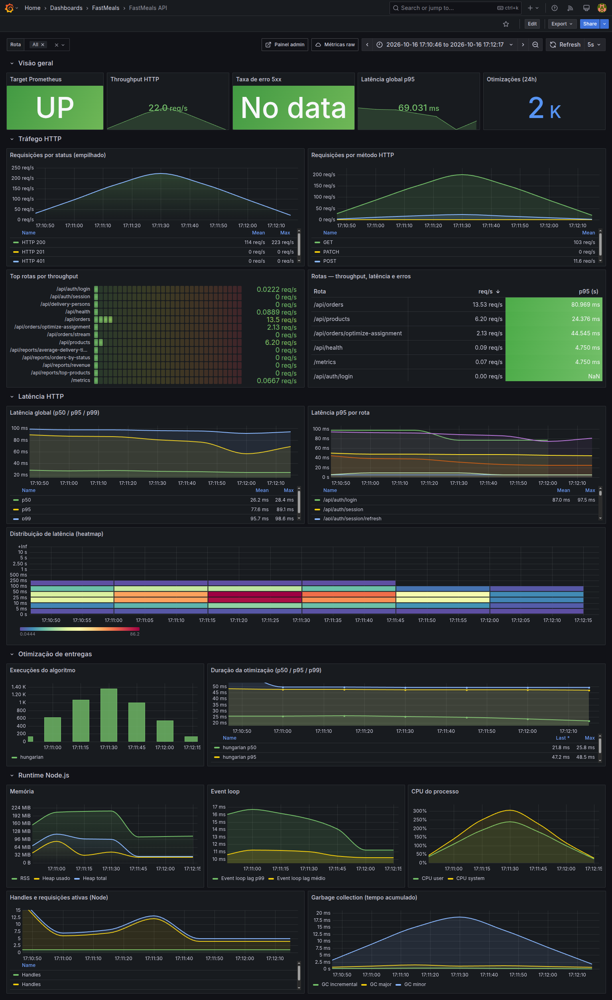
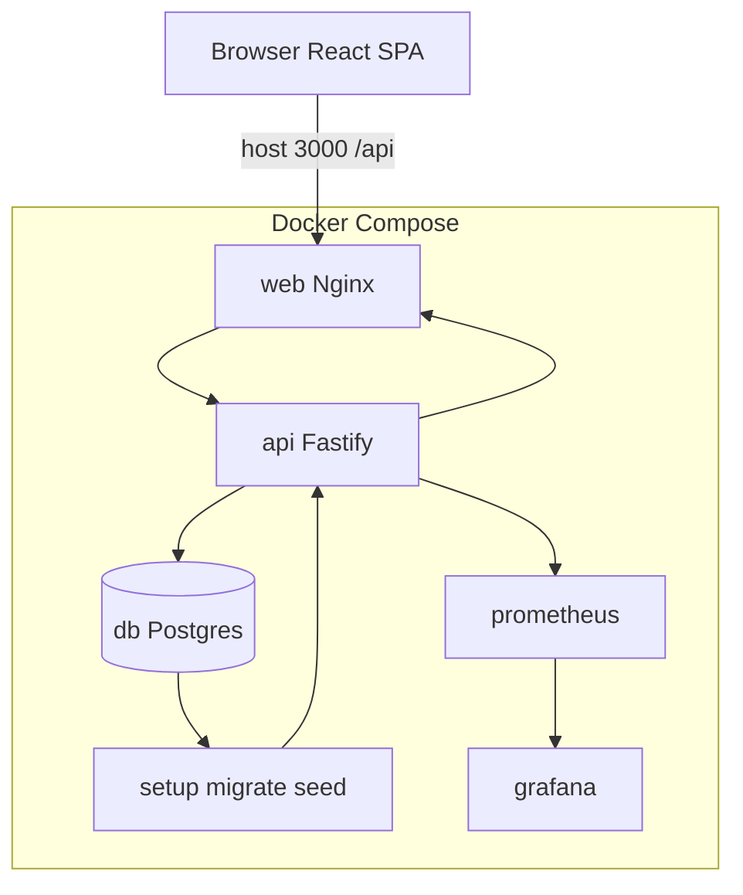
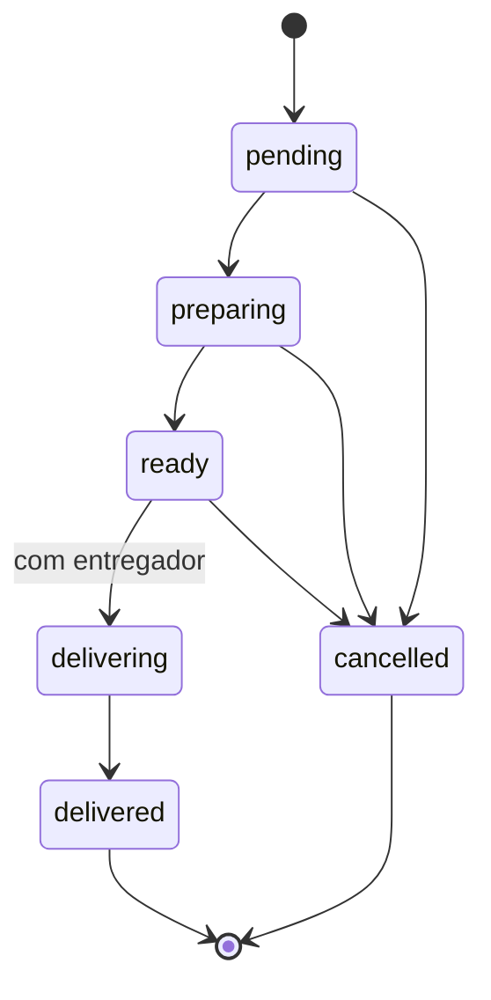
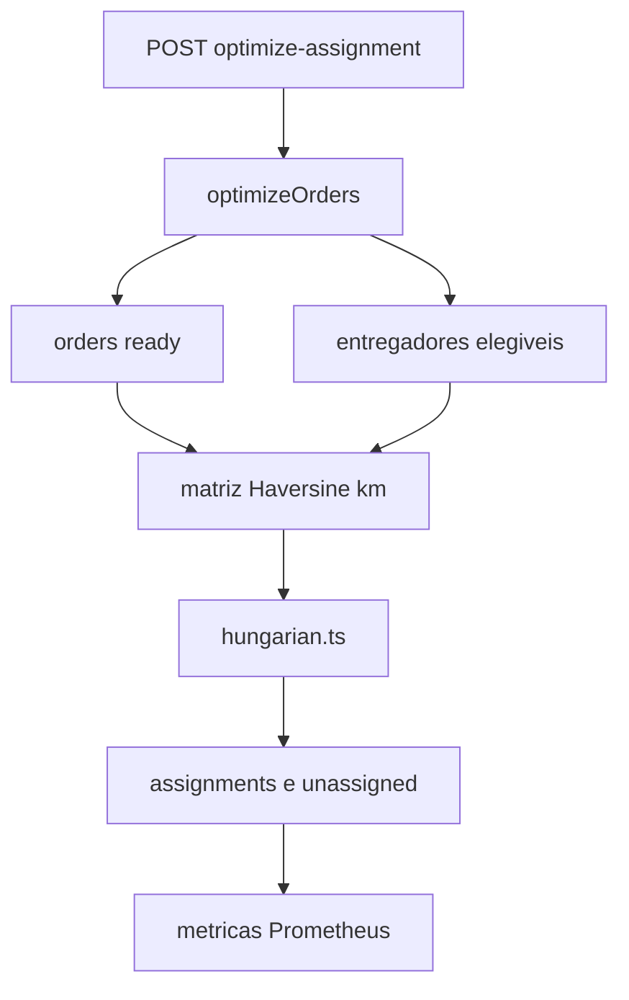

# FastMeals

[](https://github.com/MateusHoffman/FastMeals/actions/workflows/ci.yml)

Painel admin + API REST — entrega do [desafio](desafio/README.md) ([API spec](desafio/docs/api-spec.md) · [banco ref.](desafio/docs/database-schema.md) · [critérios](desafio/docs/evaluation-criteria.md)).

**Node.js** ≥ 22 (ver [`.nvmrc`](.nvmrc)).

| Para quem | Comece aqui |
| --------- | ----------- |
| **Avaliador técnico** | Siga o fluxo abaixo (~20 min) — demo acima, depois [AVALIADORES.md](AVALIADORES.md) |
| **Triagem rápida** | [docs/ONE-PAGER.md](docs/ONE-PAGER.md) |
| **Índice completo** | [docs/INDEX.md](docs/INDEX.md) |

**Fluxo sugerido (cada página linka a próxima):**  
README → [AVALIADORES.md](AVALIADORES.md) → [STANDOUT](docs/STANDOUT.md) → [REVIEW](docs/REVIEW.md) → [COMPLIANCE](docs/COMPLIANCE.md) → [DECISIONS](DECISIONS.md) → [INDEX](docs/INDEX.md)

<p align="center">
  
</p>

<p align="center">
  <a href="docs/assets/fastmeals-demo.mp4" title="Abrir o MP4 no navegador (use tela cheia no player)">
    
  </a>
</p>

<p align="center">
  <sub>Preview em loop (<code>fastmeals-demo.gif</code>) · qualidade total: <a href="docs/assets/fastmeals-demo.mp4"><code>fastmeals-demo.mp4</code></a></sub>
</p>

<p align="center">
  <a href="docs/assets/grafana-dashboard.png" title="Abrir print do Grafana em tamanho original">
    
  </a>
</p>

<p align="center">
  <sub>Observabilidade (Compose): print versionado · painel ao vivo em <strong>http://localhost:3002</strong> após <code>docker compose up --build</code></sub>
</p>

---

## Como rodar (um comando)

```bash
cp .env.example .env && docker compose up --build
```

1. Aguardar o serviço **`setup`** (migrate + seed) e o healthcheck da **`api`**
2. Abrir **http://localhost:3000**

| Acesso | URL |
| ------ | --- |
| SPA | http://localhost:3000 |
| API | http://localhost:3001/api |
| Swagger | http://localhost:3001/api/docs |
| Grafana | http://localhost:3002 |

**Seed** ([`seed/data.json`](seed/data.json)): `admin@fastmeals.com` / `Admin@123` · `viewer@fastmeals.com` / `Viewer@123`

**Gate local (lint + testes + build):** Postgres em `:5433` + migrate + seed, depois `npm run verify` — ou **`npm run verify:stack`** / `make verify-stack` (sobe só o `db`, migra, seeda e verifica).

**Local (sem Compose completo):** `docker compose up -d db` → `backend`: `npm ci && npm run migrate:deploy && npm run seed && npm run dev` → `frontend`: `npm ci && npm run dev` (Vite **:3000**, proxy `/api` → **:3001**).

**Comandos úteis:** `npm run test:summary` · `npm run e2e:smoke` · `npm run benchmark` · [`docs/INDEX.md`](docs/INDEX.md)

---

## Diferencial (evidências no código)

1. **§6 ótimo:** [`hungarian-optimality.test.ts`](backend/tests/unit/hungarian-optimality.test.ts) vs brute-force; comparativo greedy na API/UI.
2. **Pedidos:** máquina de estados + transações **Serializable** + [`orders-concurrency.test.ts`](backend/tests/integration/orders-concurrency.test.ts).
3. **Contrato:** [`api-spec.contract.test.ts`](backend/tests/contract/api-spec.contract.test.ts) vs [`desafio/docs/api-spec.md`](desafio/docs/api-spec.md).
4. **Operação:** Compose, CI (check + benchmark + E2E), [`benchmark-snapshot.json`](docs/performance/benchmark-snapshot.json).
5. **Rastreabilidade:** [`docs/COMPLIANCE.md`](docs/COMPLIANCE.md) · [`DECISIONS.md`](DECISIONS.md) · [`docs/adr/`](docs/adr/)

**Documentação:** [One-pager](docs/ONE-PAGER.md) · [Revisão 20 min](docs/REVIEW.md) · [Segurança](docs/SECURITY.md) · [Performance](docs/performance/README.md)

---

<details>
<summary><strong>Métricas (NF do desafio)</strong></summary>

Evidência versionada: [`docs/performance/benchmark-snapshot.json`](docs/performance/benchmark-snapshot.json) · reproduzir: `BENCHMARK_WRITE_SNAPSHOT=true npm run benchmark` (detalhes em [`docs/performance/README.md`](docs/performance/README.md)).

| Cenário | p50 | p95 | SLO |
| ------- | --- | --- | --- |
| `GET /api/products` (listagem, ~10k no banco) | 9,2 ms | 10,7 ms | p95 **&lt; 200 ms** |
| `GET /api/orders` | 11,1 ms | 14,2 ms | p95 **&lt; 200 ms** |
| `POST /api/orders/optimize-assignment` | 4,3 ms | 4,5 ms | p95 **&lt; 2000 ms** |
| Hungarian puro 50×30 (sintético) | — | 1 ms | **&lt; 2000 ms** |

**§6 — distância total (50 pedidos × 30 entregadores, sintético):** Hungarian **226,2 km** vs greedy nearest-neighbor **229,83 km** (mesmo dataset no snapshot).

Print Grafana (topo do README): [`docs/assets/grafana-dashboard.png`](docs/assets/grafana-dashboard.png).

> Após `npm run benchmark` com fixture 10k, re-aplique o seed: `cd backend && npm run seed:reset && npm run seed` (oracles de receita).

</details>

<details>
<summary><strong>Diagramas (arquitetura, pedidos, algoritmo)</strong></summary>

### Arquitetura (Compose + tráfego)



### Pedidos — máquina de estados



### Algoritmo de otimização



</details>

Checklist formal requisito → artefato: [`docs/COMPLIANCE.md`](docs/COMPLIANCE.md) (no fluxo, vem depois de [REVIEW](docs/REVIEW.md)).

---

**Próximo →** [AVALIADORES.md](AVALIADORES.md) — subir a stack, login admin e momento §6 (Hungarian vs greedy na UI)
